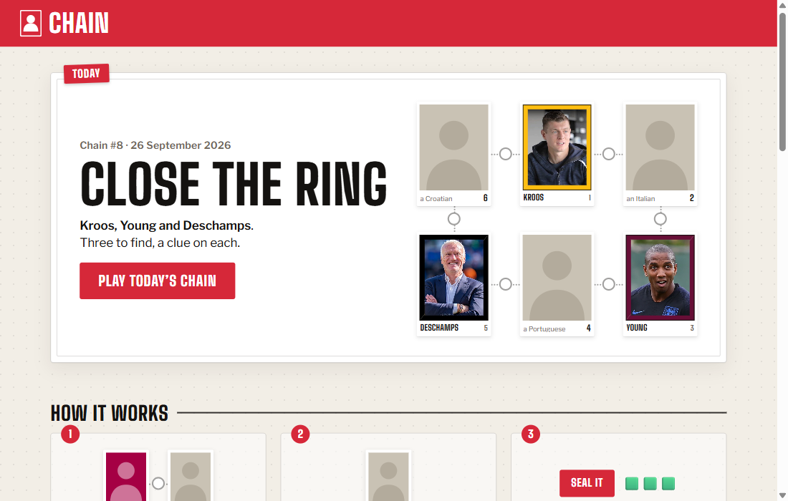
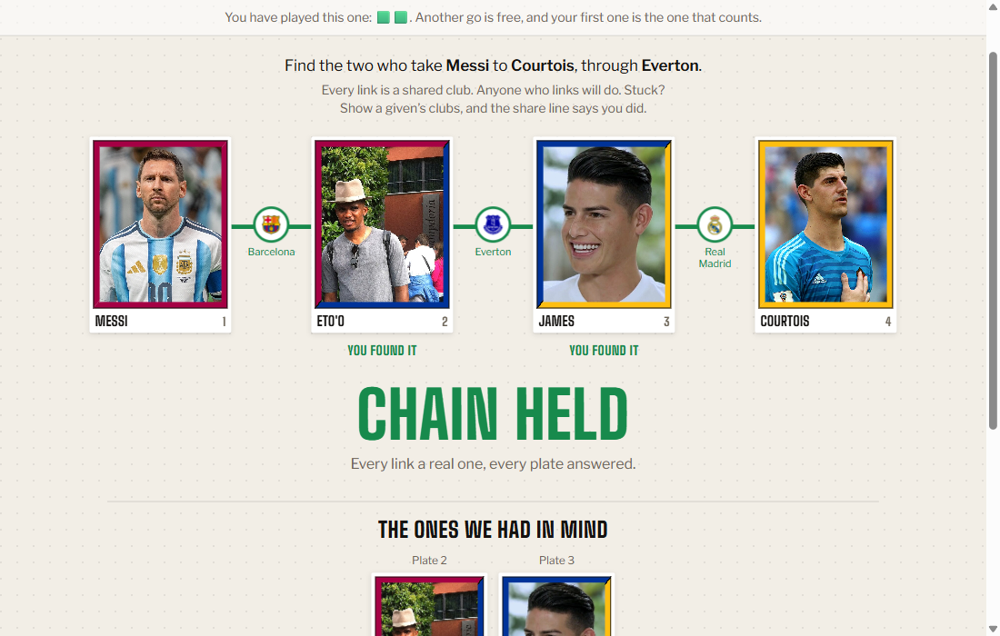
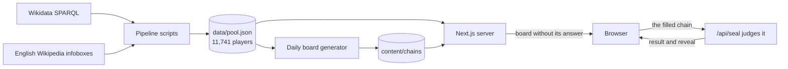

# Chain

A daily football puzzle drawn as a sticker album. Two or more famous players are on the page, with gaps between them. Name the missing players so that each neighbouring pair played for the same club, then seal the page and find out whether your chain holds.

**Play it:** https://football-chain.vercel.app





## How to play

- **The daily.** A ring of three or four givens, with a clue on every empty plate ("an Argentine", "a Welshman"). Every board is built so that each plate has one answer a fan can reach. Everyone gets the same board on the same day, and your streak counts the days in a row you held it.
- **The ladder.** Four graded boards, from easy to a closed ring. Anyone who links will do; harder means fewer people who fit.
- **No suggestions.** The search never offers a name. You type a player you remember, and the board tells you nothing until you seal it. If you get stuck, "Show clubs" reveals a given's clubs, and your share line records that you used it.

The same player database runs two party games for playing in a group with one phone:

- **Rondo** (`/rondo`): pass the ball to anyone who shared a club with the player on it. Each club can be used once per ball; run out of links and you lose the ball.
- **Slugger** (`/slugger`): football played as baseball. The pitcher names a club and the batter names someone who played for it. Big clubs are singles; small clubs are home runs.

## How it works



- **Data.** The player pool is defined by criteria (fame, era, occupation) rather than by crawling clubs. Players, clubs and nationalities come from Wikidata. Wikidata's club history stops mid-career for about a third of players, so careers are completed from English Wikipedia infoboxes: that merge added 14,795 missing club spells to 7,057 players. "Fame" is the number of Wikipedia language editions a player has, a free, reproducible stand-in for how well known someone is.
- **Data traps are tested.** Three query mistakes silently drop famous players (a label-language migration that loses Beckham, Mbappé and Ramos; truncation of "truthy" statements; national teams mixed in with clubs). Each has a regression test in `tests/pipeline/traps.test.ts`, and the example queries in `docs/superpowers/specs/queries/` prove each one.
- **Names are checked for vandalism.** Wikidata is community-edited and labels get defaced. A heuristic flags the obvious cases (meme words, digits, lookalike Greek or Cyrillic letters), and a one-off comparison of all 11,741 names against their Wikipedia article titles found sixteen more. One had relabelled Marc Bartra as "Ronaldo", so searching Ronaldo offered two players, one of whom was judged on the wrong career. Corrections live in `src/pipeline/overrides.ts`.
- **The answer never reaches the browser.** On a chain, each blank has exactly two neighbours, so one leaked player id gives the puzzle away. The page ships the givens and the clues only. The fill is sent to `/api/seal`, which validates it and judges every link on the server.
- **Boards are generated, then held to their promise.** `scripts/build-completion.ts` builds the dailies from famous givens and is seeded, so a rerun writes the same boards. A test re-checks every board: on each plate, the intended answer must be a well-known fact (fame 50 or above) and the next-best candidate must be much less so (under 35). A board that stops meeting that rule, for example after the data changes, fails the test suite.
- **Photos are licensed.** Deployed builds show only Wikimedia Commons photos (portraits on the shipped boards are checked against each player's career dates), and `/credits` lists the author and licence of every one.

## Tech stack

Next.js 15 (App Router) and React 19, TypeScript throughout, Vitest (989 tests), and `tsx` scripts for the data pipeline. There is no database: the pool is a committed JSON snapshot read once by the server. Drag and drop uses dnd-kit.

## Run it locally

Tested on Node.js 24 (Next.js 15 needs 18.18 or later).

```bash
npm install
npm run dev         # http://localhost:3000
npm test
npm run typecheck
```

The data is committed, so the app runs without fetching anything. The pipeline scripts (`npm run fetch:pool`, `build:pool`, `fetch:careers`, `merge:careers`, `fetch:portraits`, `fetch:credits`) rebuild it from the live sources.

## Project layout

| Path | What |
|---|---|
| `app/` | Routes: the album (`/`, `/play/[id]`), Rondo, Slugger, the API routes, and `/credits` |
| `components/` | The board, stickers, search sheet, reveal and Slugger UI |
| `games/rondo/` | Rondo, kept self-contained |
| `src/lib/chain/` | The rules: links, fields, results, the share line |
| `src/server/` | Loading the pool once, stripping answers, judging |
| `scripts/` | Data pipeline and board generator |
| `data/`, `content/` | The player pool and the boards |
| `tests/` | Unit tests, data-trap tests, and a test that holds every shipped board to its rules |

## Known limits

- Links ignore time: a player who left a club before another arrived still links to them. Requiring overlap would leave the harder boards with no answers.
- Some well-known players are missing. A filter meant to keep out singers who once played (Julio Iglesias kept goal for Real Madrid's youth side) also drops footballers who sing, among them Ronaldinho and Eric Cantona; and about a hundred players, Pedri and Jan Oblak among them, are dropped because Wikidata lists their position under an item the pipeline does not map yet.
- The pool has no aliases, so a player known by a name that is not part of his label cannot be found by it.
- Fame is global, so a few givens are better known abroad than in Britain.

## Credits and licence

Code is MIT licensed (see `LICENSE`). The data belongs to its sources: Wikidata (CC0), English Wikipedia (CC BY-SA 4.0), and the photographers and clubs listed on the app's `/credits` page. This is an unofficial fan project, not affiliated with any club, league or player.
